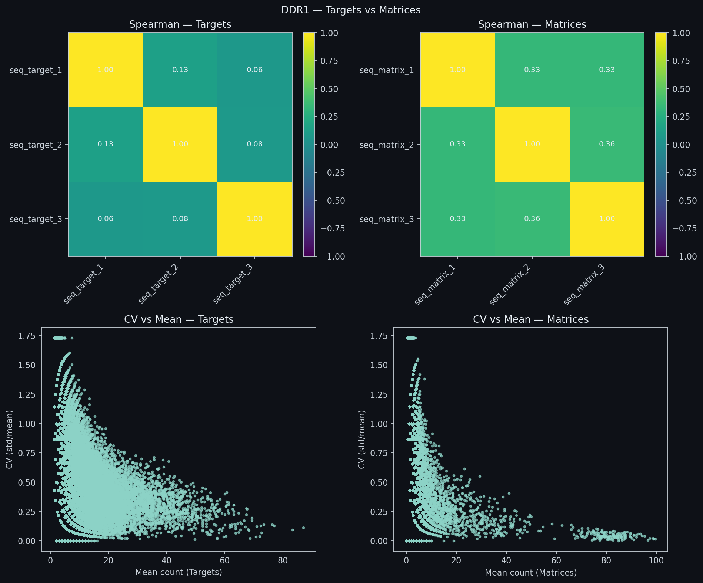
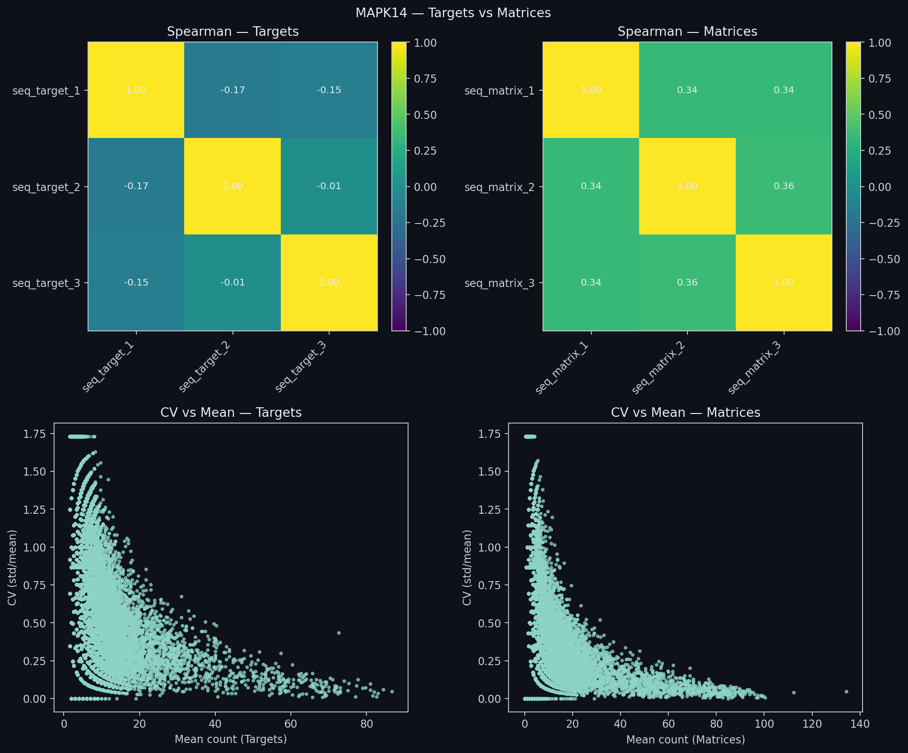
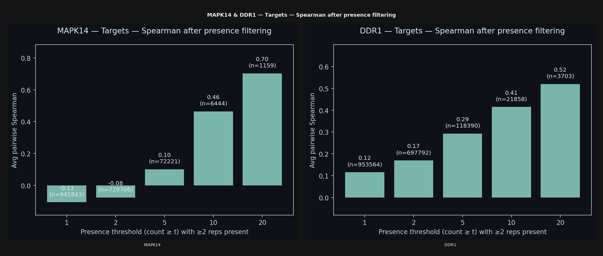

### Problem Identification & Caveats

While DNA-Encoded Libraries (DELs) enable ultra-high-throughput screening, enrichment scores derived from on-DNA selections exhibit several limitations that must be acknowledged before training predictive models:

- **On-DNA vs Off-DNA Binding Discrepancy**  
  Enrichment scores are obtained while compounds are attached to a DNA tag and linker. These tags can introduce steric or conformational artifacts that alter interaction with the kinase binding pocket.  

  **Main Idea:**  
  In addition to structural interference from the linker, individual DNA barcodes themselves may contribute unevenly to enrichment scores due to differences in PCR amplification efficiency or sequence-specific behavior. This creates a risk that enrichment reflects DNA-artifact signals rather than true ligand–target affinity.  

  **KinDEL Dataset Caveat:**  
  The KinDEL dataset aggregates counts across redundant barcodes to dampen these biases. However, this approach cannot fully eliminate them: some barcodes may consistently amplify better, redundancy is limited, and possible interactions between barcode sequence and chemistry are masked by aggregation. Since the released tables exclude raw barcode sequences, these effects cannot be directly tested. KinDEL partially mitigates PCR bias via redundant encodings, triplicate counts, and pre-selection loads. Still, without barcode sequences, sequence-motif amplification biases cannot be corrected directly; we instead rely on replicate-aware modeling and variance-derived weights as proxies.  

  **Supporting Sources:**  
  > “The finding that DECL selections miss many active molecules raises the question for the underlying cause of this effect. We hypothesized that the structural constraints imposed by the DNA-attachment linker might hinder target engagement of molecules that would otherwise exhibit activity.”  
  > — *(https://pubs.rsc.org/en/content/articlelanding/2025/sc/d5sc00844a)*  
  >
  > “Barcode sequence composition can systematically affect read counts independent of biological signal.”  
  > — *Modeling and correction of barcode sequence biases in high-throughput sequencing data* (arXiv:1402.6775)  

  **Key Question Raised:**  
  _How can models correct for barcode-specific effects so enrichment scores more faithfully reflect biochemical binding affinity rather than DNA tag artifacts?_

- **Experimental Noise & Modeling Challenges**  
  DEL data are derived from **noisy sequencing counts**, which are affected by both experimental variability and statistical instability.  
  - **Reaction yield:** Some compounds are synthesized less efficiently, so they appear weak even if they bind well.  
  - **PCR bias:** Certain tags amplify more readily, creating false positives.  
  - **Low-count instability:** Ratios of small numbers (e.g., 3 vs. 1 reads) can exaggerate changes that are just random noise.  

  **Main Idea:**  
  Because noise arises both from chemistry and sequencing, enrichment should not be treated as a clean continuous variable. Instead, count-based statistical models (e.g., negative binomial or Bayesian approaches) provide a more robust way to estimate binding signals. In practice, replicate CVs in KinDEL disynthon splits are high (~0.83), replicate correlations are weak (~0.30), and dropout is common (~17% of molecules present in all replicates). This quantifies the noise floor our models must contend with.  

  **Supporting Sources:**  
  > “Variable reaction yields and PCR amplification efficiencies inject noise into DEL selection data.”  
  > — *KinDEL: DNA-Encoded Library Dataset for Kinase Inhibitors*  
  >
  > “ADD NB model QUOTE”  

  **Key Question Raised:**  
  _What modeling strategies can best separate true binding signal from experimental noise in DEL count data?_  

  

- **Sparse and Biased Validation**  
  Off-DNA affinity measurements (Kd) were obtained only for a deliberately selected subset of compounds, chosen using an ensemble of predictive models followed by Butina clustering on Morgan fingerprints to ensure chemical diversity. While this strategy captures a range of predicted pKd values, it introduces a model-driven selection bias and excludes the vast majority of on-DNA compounds, especially low-affinity or noisy binders.  

  **Main Idea:**  
  Validation compounds are not drawn randomly from the library but are instead enriched for chemically diverse, predicted high-affinity binders. This limits our ability to estimate model performance across the full range of DEL hit quality and may overestimate generalization.  

  **Supporting Sources:**  
  > “We selected validation compounds to cover a range of KD values and chemical diversity ... using an ensemble of models ... then clustered the molecules based on chemical similarity via Butina clustering using Morgan fingerprints.”  
  > — *KinDEL* (arXiv:2410.08938)  
  >
  > “DEL validation sets generally lack randomly sampled negatives, complicating model calibration.”  
  > — Gerry & Schreiber, *Nature Chemical Biology* 2018  

  **Key Question Raised:**  
  _How do we train and evaluate models fairly in the presence of a highly biased and sparsely labeled ground-truth set?_

- **Target Scope Constraint**  
  The KinDEL dataset focuses exclusively on two kinases (MAPK14 and DDR1).  

  **Main Idea:**  
  The narrow target diversity, even within the kinase family, raises concerns about the model’s ability to generalize to other kinases with different binding site geometries. A model trained on MAPK14 may capture features idiosyncratic to that kinase rather than representations that are transferable to other kinase targets (such as DDR1 or beyond).  

  **Supporting Sources:**  
  > “Models trained on a single kinase often show limited transferability even to related kinases with subtly different ATP pocket shapes.”  
  > — Bender et al., *Molecular Informatics* 2021  

  **Key Question Raised:**  
  _How well do models trained on enrichment data from one kinase transfer to another kinase target, and can joint or multi-task training improve intra-kinase generalization?_

### Interpretation of Model Results, Hypotheses & Suggested Tests  

---

1. **Probabilistic Modeling Improves Off-DNA Generalization**  
   - Most DEL modeling has optimized for fitting on-DNA enrichment.  
   - Probabilistic, count-based models (e.g., DEL-Compose) may *fit enrichment worse* but *predict true affinities better*.  
   - This reframes what “good performance” means — shifting from enrichment fit to biological generalization.  
   → *Suggested test:* Compare how models rank held-out off-DNA validation compounds across splits. If probabilistic models consistently outperform enrichment-based baselines in off-DNA ranking, it confirms they better capture true binding signals.  

2. **Disynthon Splits Reveal Generalization Limits**  
   - Standard random and cluster splits allow synthon overlap between train and test, inflating results.  
   - Disynthon splits deliberately break synthon overlap, forcing models to extrapolate to unseen fragment combinations — this exposes memorization in fingerprint-based models.  
   - Our diagnostics further show that, across different disynthon seeds, chemical overlap with training remains extremely high (median max Tanimoto = 1.0). The large variance in performance therefore stems less from scaffold novelty and more from replicate instability and enrichment distribution shifts.  
   → *Suggested test:* Compare fingerprint-based vs. structure-aware models (e.g., GNNs). If GNNs degrade less under disynthon splits, it supports the fragment-memorization hypothesis. If variance across splits correlates with replicate CV and dropout rates, it supports the noise-driver hypothesis.

3. **Rare Disynthon Combinations May Drive High Variance**  
   - Disynthon split performance varies sharply across seeds. Our diagnostics show consistently high replicate noise across all splits (CV ~0.83, correlations ~0.30), so noise alone cannot explain the differences.  
   - This suggests an additional factor: certain synthon pairs are under-represented in training, and when they dominate a test split, errors spike.  
   → *Suggested test:* Quantify the training frequency of each synthon pair and correlate with model residuals. If higher residuals track with rare pairs, it would confirm sparsity as a driver of instability.

4. **DDR1 is a Harder Target than MAPK14**  
   - Models predict DDR1 less reliably than MAPK14, with weaker on/off-DNA correlation.  
   - This reflects typical target-to-target variability in DEL data.  
   - Even though MAPK14's dataset looks noisier at first glance (more low-count singletons), when filtering the data, the signal is much stronger of MAPK14 data, than on DDR1 - see spearman correlation plots.  
   - Looking into uniprot's respective pages, we can tell that:  
        - DDR1 is a membrane protein, while MAPK14 is intracellular (much easier, in general for affinity assays)  
        - DDR1 has many more known PTMs  

## Proposed Model Architectures

### Option 1 — Noise-Aware Weighted Tree & Neighbor Models
**Rationale.** Enrichment ratios are noisy and heteroskedastic. Full probabilistic models (e.g., DEL-Compose) are principled but heavier to deploy.  
Weighted tree- and neighbor-based models offer a **middle ground**: simple, scalable, and interpretable, while downweighting noisy low-count compounds without the complexity of full likelihood models. They are also easy to productionize (feature store → batch/online inference).

**Approach.**
- Use **Random Forests, XGBoost,** and **k-Nearest Neighbors** on enrichment-derived features (ECFP/Morgan, synthon descriptors, optional physchem).
- Apply **per-sample reliability weights** (e.g., `w = log(1 + total_counts)` or inverse-variance from a NB fit) so high-depth compounds influence the model more.
- Optionally, fit a **negative binomial model on replicate counts** to derive variance estimates and use their inverse as principled weights. This grounds the weighting in count statistics rather than heuristics.

---

### Option 2 — ChemBERTa for DEL Data
**Rationale.** Fingerprint-based models may overfit to fragment overlap, especially under **disynthon** splits. Transformer-based models like **ChemBERTa** can capture richer molecular context and generalize better across scaffolds.  
By combining pretrained embeddings with **count-aware training**, ChemBERTa can learn contextual chemical features while remaining robust to noisy, low-count compounds. This design also extends naturally to multi-task setups across multiple kinases.

**Approach.**
- Fine-tune **ChemBERTa**, a pretrained SMILES encoder, on DEL compounds.  

## Experimental Design and Active Learning
PCR/Sequencing–Aware Molecule Selection for Kd (beyond ensemble + Butina)

KinDEL chose validation compounds via an ensemble and Butina clustering on Morgan FPs to span chemical diversity and predicted Kd. We complement that with PCR/seq–aware picks so Kd labels deconfound barcode and count noise. 

- Uncertainty targeting. Fit a replicate-aware NB/ZIP over target/control/pre counts; prioritize molecules with highest posterior variance in log-enrichment (closest to the decision boundary).

- Replicate discordance & residuals. Add top-CV molecules and large target-vs-control NB residual outliers to separate binding from amplification effects.

- Depth × enrichment grid. Sample evenly across low/med/high pre-depth × neg/near-zero/pos NB-shrunk enrichment to stabilize low-count regimes.

- Discordant neighbors. Within tight chemical neighborhoods (high Tanimoto), pick pairs with divergent counts to test SAR vs PCR artifacts.

- Rare disynthon coverage + dropouts. Include under-represented synthon pairs with informative counts, and explicit zero-inflated “dropout” cases to calibrate the likelihood.

These choices directly address linker/barcode artifacts and PCR bias documented for DELs, making off-DNA Kd labels more informative for the model than diversity-only selection. 

Whishful thinking DoE: 
Active learning option. Run the same selection in batches: start with a small pilot Kd, fit the replicate-aware count model and predictors, compute an acquisition score per molecule (e.g., uncertainty in log-enrichment + target–control residual magnitude + ensemble disagreement), enforce quotas for the depth×enrichment grid, rare disynthons, and dropouts, then select a cost-limited batch, measure Kd, retrain, and iterate. Keep ~10–20% exploration (random/diversity picks) to avoid bias, and stop when calibration and held-out off-DNA ranking no longer improve.

## Future Work

Evaluate effectiveness of different weights for noise aware models  
Test chemberta regression  
Test model transferability  
